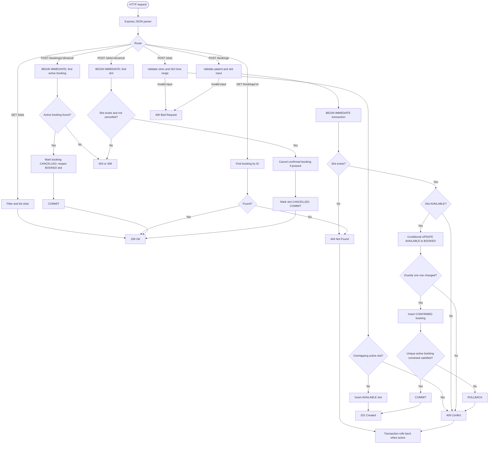
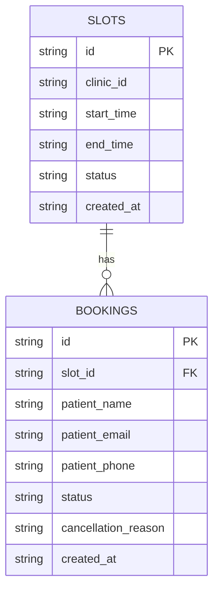

# Clinic Appointment Booking API

A REST API for clinics to publish appointment slots and for patients to reserve and cancel appointments. Built with TypeScript, Express, and SQLite.

## Requirements

- Node.js 22 or later (uses the built-in `node:sqlite` module)
- npm

## Setup

```bash
git clone https://github.com/7gautamkumawat7/clinic-appointment-api.git
cd clinic-appointment-api
npm install
npm start
```

The server listens at `http://localhost:3000`. By default, it stores data in `clinic_booking.db` in the working directory. Set `PORT` and `DB_PATH` to override these defaults.

```bash
npm run dev         # Watch mode
npm run build       # Compile TypeScript
npm run start:dist  # Run compiled server
npm test            # Run automated tests
```

## Request flow



The booking operation is protected by a SQLite write transaction, an atomic conditional status update, and a partial unique index that permits only one `CONFIRMED` booking per slot. Cancelling a patient booking makes its slot available again; cancelling a clinic slot prevents further bookings.

## API endpoints

| Method | Path | Purpose |
| --- | --- | --- |
| GET | `/` | API overview |
| GET | `/health` | Health check |
| POST | `/slots` | Create a slot |
| GET | `/slots` | List slots, optionally filtering by `clinic_id` and `status` |
| POST | `/slots/:id/cancel` | Cancel a slot and its confirmed booking, if any |
| POST | `/bookings` | Reserve an available slot |
| GET | `/bookings/:id` | Fetch booking details |
| POST | `/bookings/:id/cancel` | Cancel a booking and reopen its slot |

## Example requests

Create a slot:

```bash
curl -X POST http://localhost:3000/slots \
  -H "Content-Type: application/json" \
  -d '{"clinic_id":"clinic-1","start_time":"2026-11-01T09:00:00.000Z","end_time":"2026-11-01T09:30:00.000Z"}'
```

The response contains the generated slot `id`. Use it for the next request:

```bash
curl "http://localhost:3000/slots?clinic_id=clinic-1&status=AVAILABLE"

curl -X POST http://localhost:3000/bookings \
  -H "Content-Type: application/json" \
  -d '{"slot_id":"REPLACE_WITH_SLOT_ID","patient_name":"Alex Smith","patient_email":"alex@example.com"}'
```

Use the returned booking `id` to retrieve or cancel it:

```bash
curl http://localhost:3000/bookings/REPLACE_WITH_BOOKING_ID

curl -X POST http://localhost:3000/bookings/REPLACE_WITH_BOOKING_ID/cancel \
  -H "Content-Type: application/json" \
  -d '{"reason":"Schedule changed"}'
```

Cancel a clinic slot:

```bash
curl -X POST http://localhost:3000/slots/REPLACE_WITH_SLOT_ID/cancel
```

### Responses and validation

Successful creation returns `201`. Successful reads and cancellations return `200`. Invalid input returns `400`, missing resources return `404`, and conflicting operations (including duplicate bookings or overlapping clinic slots) return `409`. Unexpected errors return `500`. Errors use a JSON `error` field.

## Data model



Slots have `AVAILABLE`, `BOOKED`, or `CANCELLED` status. Bookings have `CONFIRMED` or `CANCELLED` status. A partial unique index on `bookings(slot_id)` where `status = 'CONFIRMED'` prevents multiple active bookings for one slot.

## Project structure

```text
src/
  app.ts                  Express app and error handler
  index.ts                Server entry point
  db.ts                   SQLite schema and transaction helper
  errors.ts               HTTP error type
  types.ts                Domain types
  routes/
    slots.ts              Slot endpoints and validation
    bookings.ts           Booking endpoints and validation
  services/
    slot.service.ts       Slot operations
    booking.service.ts    Booking operations
tests/
  booking-rules.test.ts   Booking rules and API tests
```

## Tests

Run `npm test` to exercise slot creation and cancellation, booking and reopening, sequential duplicate booking prevention, 20 concurrent booking requests for the same slot, and validation errors. The concurrency test expects exactly one successful booking and 19 conflict responses.

The automated concurrency test runs requests against one application instance. It does not by itself verify behavior across multiple processes or machines.
